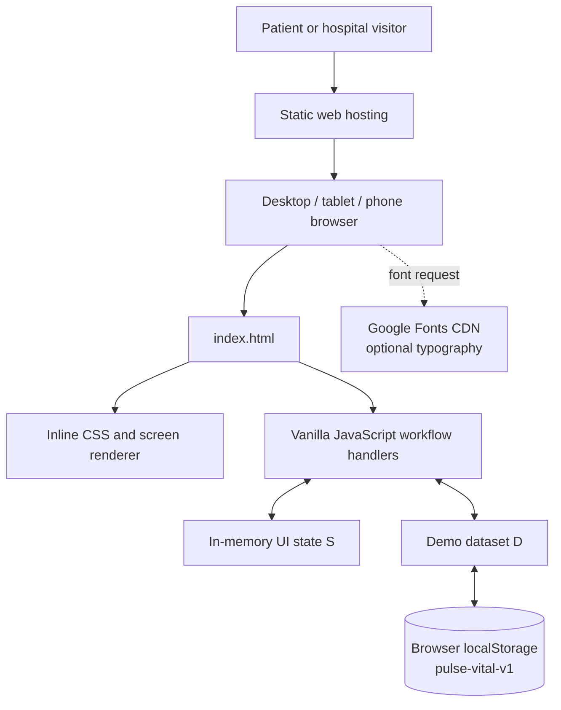
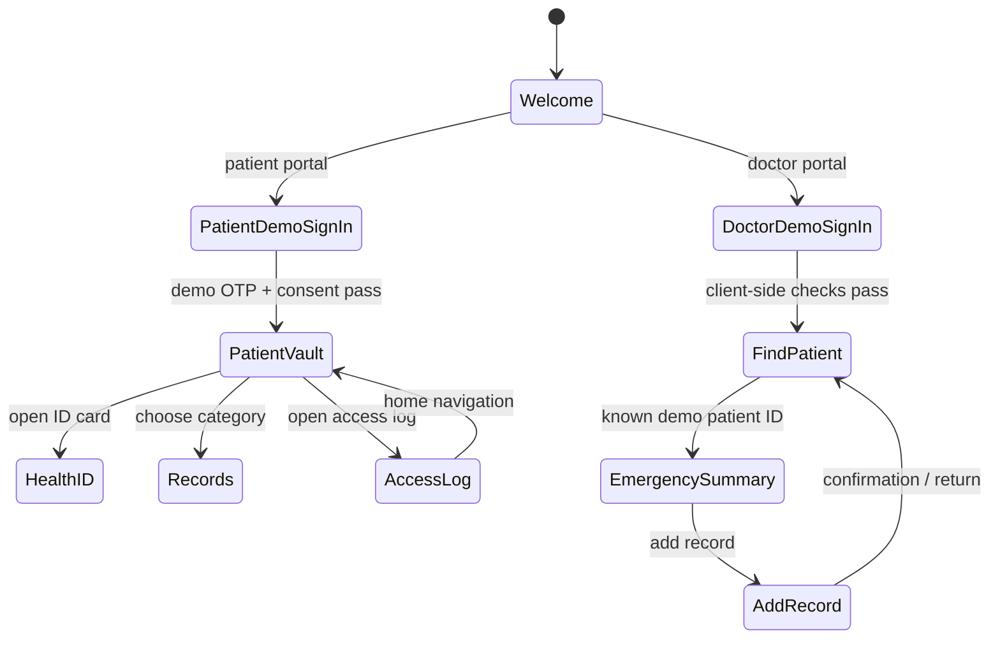
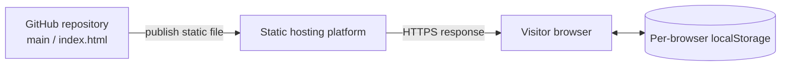

# Pulse & Vital — Technical Design Document

**Document status:** Design of the current static demo prototype  
**Application:** Pulse & Vital  
**Live responsive demo:** https://pulse-vital-d0f8fj.v2.appdeploy.ai/  
**Source entry point:** `index.html`

## 1. Purpose and scope

Pulse & Vital demonstrates how a patient may view a consolidated health-vault interface and how a hospital user may find a demo patient, view emergency information, inspect records, and add a record. It is a frontend prototype, not a connected healthcare platform.

This document describes the code in the repository and its intended user-facing workflow. The current implementation has no application server or remote persistence. The responsive hosted presentation is a CSS/layout treatment of the same demo workflows.

### In scope

- Separate patient and doctor/hospital flows.
- Demo OTP inputs and validation.
- Sample record browsing and record-category filtering.
- Health ID/QR-style visual and short-lived demo code.
- Emergency summary, access history, and emergency contact editing.
- Doctor-side patient lookup, synthetic access logging, and record-entry simulation.
- Browser-local sample data persistence.

### Out of scope

- Real identity verification or SMS delivery.
- Real doctor/hospital identity provider or authorization.
- A production patient database, cross-border exchange, or interoperability service.
- Actual QR scanning, medical imaging upload/storage, or FHIR serialization.
- Clinical decision support, diagnosis, or emergency dispatch.

## 2. High-level architecture

The system is a static web application. All rendering and workflow logic runs in the user's browser.



**Architecture notes**

1. The hosting layer only serves static files.
2. `index.html` contains the screen templates, CSS, demo seed data, and event handlers.
3. The screen renderer selects a template using the in-memory route key `S.r`.
4. Demo records and user-edited emergency-contact details are saved in `localStorage` under `pulse-vital-v1`.
5. Google Fonts is an optional external presentation dependency; system font fallbacks remain configured.
6. No server, API, database, SMS service, camera API, or medical-record storage service is called.

## 3. Main UI areas and navigation

The screen map is implemented through the `SC` screen definitions and the `go()` navigation guard.

| Screen key | User-facing area | Main behavior |
| --- | --- | --- |
| `s1` | Welcome / portal choice | Select patient or doctor portal; choose interface language. |
| `s2` | Patient demo sign-in | Validate 12-digit Aadhaar-shaped input and 10-digit phone input; generate a demo OTP; require the consent checkbox. |
| `s3` | Patient vault | Display patient ID, record counts, and record-category tiles. |
| `s4` | Health ID card | Show a QR-style visual and a time-rotating demo code; print or demonstrate wallet action. |
| `s5` | Records | Browse a record category and expand record details; use sample imaging illustration where applicable. |
| `s6` | Access log / profile | View access events or personal details; edit emergency contact; sign out of patient demo. |
| `s7` | Doctor sign-in | Check the demo hospital ID, email syntax, and minimum password length. |
| `s8` | Find a patient | Look up a patient ID, view recent lookups, or launch the emergency view. |
| `s9` | Emergency summary | Show blood group, allergy/medicine data, emergency contact, and selected record categories; record a local access event. |
| `s10` | Add a record | Select record type, enter title/note, simulate a file upload, and create a sample verified record. |

### Navigation and roles

The app keeps patient and doctor session flags in JavaScript memory. Patient screens are guarded by the in-memory `S.pin` flag and doctor screens by `S.din`; the doctor patient-summary route also requires a local patient-lookup state. These are UI guards, **not security boundaries**: any visitor can inspect or modify client-side code and storage.



## 4. Important workflows

### 4.1 Patient demo sign-in

1. The user enters a 12-digit numeric value and a 10-digit phone number.
2. Selecting **Send OTP** creates a random six-digit value in the browser, pre-populates the six OTP inputs, and shows the code in a toast.
3. The user must pass the value comparison and select the consent checkbox.
4. The app sets the in-memory patient session flag and opens the vault.

**Production gap:** the OTP is not delivered to a phone and identity is not checked against an external identity provider. The UI must not be used to collect real Aadhaar or mobile data.

### 4.2 Health vault and local persistence

- The demo seed contains record types such as scans, blood/lab, medicines, allergies, surgery, eye care, Ayurvedic care, and full-body checks.
- The data object `D` contains `rec`, `log`, `look`, and `ec` collections/objects.
- `save()` serializes `D` into browser local storage. The in-memory navigation/session state `S` is not stored as an authenticated session.
- Data persists only in the same browser profile and origin. It does not sync across devices and may be edited by a user with access to browser developer tools.

### 4.3 Hospital demo lookup and emergency summary

1. A demo hospital ID must match the hard-coded allowlist.
2. The user must provide an email-shaped value and a password of at least six characters.
3. The user searches for the seeded patient ID `HP-2026-000001`.
4. A match adds an entry to the local `D.log` and `D.look` arrays.
5. The emergency summary renders sample blood group, allergies, medicines, emergency contact, and record summaries.

An unknown ID is rejected with visible validation text. The access log is only a browser-side demo log and is not tamper-resistant.

### 4.4 Add a record

- The user selects a record type and may supply a title and doctor's note.
- A file picker retains file metadata in current JavaScript state only. The displayed progress is simulated; file bytes are not uploaded to a server.
- The workflow requires a completed simulated upload or a non-empty note before signing.
- On success, a new record and local access-log event are added to `D`, then saved in `localStorage`.

The “verified” label is only a demo status. There is no cryptographic signature, clinician identity service, server-side verification, or actual FHIR conversion.

## 5. Data model

The persisted object is initialized by `seed()` and serialized under `pulse-vital-v1`.

| Path | Shape | Description |
| --- | --- | --- |
| `D.rec[]` | `{ t, ti, d, by, h, pv?, em? }` | Sample medical record: type key, title, ISO-like date, provider, hospital/clinic, and optional demo imaging/emergency flags. |
| `D.log[]` | `{ h, dr, w, at }` | Local access or add-record audit display event: hospital, doctor, action, and display timestamp. |
| `D.look[]` | `{ id, k, at }` | Recent patient lookup: patient ID, lookup type, and display timestamp. |
| `D.ec` | `{ n, p }` | Emergency-contact display name/relation and phone string. |

The patient identity and hospital allowlist are separate hard-coded constants in the UI code; they are not part of the saved `D` object.

### Record type keys

| Key | Category |
| --- | --- |
| `scan` | Scans and imaging |
| `blood` | Blood and lab |
| `med` | Medicines |
| `allergy` | Allergies |
| `surgery` | Surgeries |
| `eye` | Eye care |
| `ayur` | Ayurvedic care |
| `full` | Full-body check |
| `hist` | Derived timeline view across records |

See [sample-data.json](../tests/sample-data.json) for a synthetic fixture following the saved data shape.

## 6. Environment and deployment

### Environment variables

There are currently **no required environment variables**. The app reads no `.env` file, API keys, or server configuration. The live hosting provider has independent deployment metadata, but that metadata is not consumed by the static page.

### Local development

```bash
git clone https://github.com/vishnupriyakv2008-ctrl/pulse-vital.git
cd pulse-vital
python -m http.server 8000
```

Open http://localhost:8000. Alternatively, use `npx --yes serve . -l 8000`. No package installation or build step is needed for this single-file prototype.

### Deployment topology



Hosting serves the static application; it does not create a backend or securely centralize health information.

## 7. Responsive UI and accessibility considerations

The deployed responsive version uses fluid containers and viewport-dependent layout changes rather than a fixed-width phone mockup. The patient content expands to available width, doctor navigation can wrap horizontally, and summary/grid regions collapse to fewer columns on smaller screens. Keyboard focus styling, accessible labels for key inputs, role-based error text, and modal dialog labels are present in the prototype.

Manual responsive checks should include at least 1440 × 900 desktop, 768 × 1024 tablet, and 390 × 844 mobile viewports. Verify no horizontal overflow, readable record rows, accessible form controls, and usable modal actions.

## 8. Security, privacy, and reliability assessment

| Area | Current state | Required before production |
| --- | --- | --- |
| Authentication | Client-side demo checks; OTP is generated/displayed in browser. | Server-validated identity and session management, MFA, secure recovery, rate limiting. |
| Authorization | In-memory route guards and hard-coded hospital allowlist. | Server-side role/attribute-based authorization and least privilege. |
| Storage | Browser local storage, readable/modifiable by same-origin JavaScript. | Protected API and database, encryption at rest/in transit, backups, lifecycle and deletion policy. |
| Audit log | Browser-side arrays that the user can alter/reset. | Append-only server audit trail, timestamps, actor identity, monitoring. |
| Files | Filename/size/progress UI only. | Secure upload, content inspection, access-controlled object storage, malware scanning, retention controls. |
| QR | Illustrative QR-style grid and browser-generated time token. | Standards-compliant QR payload, signed short-lived token, replay protection, server verification. |
| Interoperability | FHIR type labels are display metadata only. | Validated FHIR resources, terminology mapping, schema validation, consent and exchange policy. |
| Secrets/configuration | No environment variables or API secrets. | Keep all credentials server-side; never embed secrets in front-end source. |

**Do not use this prototype to store real health data or to make clinical decisions.** A production-grade health vault needs a separate backend/security design review and compliance review for every jurisdiction it serves.

## 9. Suggested next increments

1. Introduce a backend API and a real identity provider; remove browser-generated OTP and client-side hospital authentication.
2. Add a role-aware data model and database with encryption, access controls, retention, backup, and audit requirements.
3. Implement secure record storage, verified clinician signatures, valid FHIR interchange, and an independently reviewed QR/token protocol.
4. Add automated unit, integration, accessibility, and responsive end-to-end tests plus CI checks.
